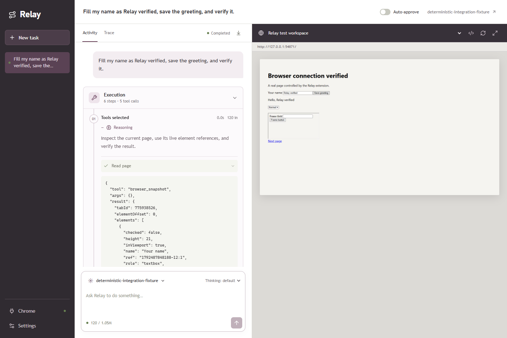

# Relay

Your own prompt-driven Chrome agent. Bring an OpenAI-compatible endpoint, choose a model, write a task, and inspect every request and browser action.

Relay runs on your computer. A small Chrome extension connects your existing tabs and signed-in sessions to the local backend. The interface uses Anthropic's frontend-design guidance; the runtime has no dependency on Anthropic or a hosted browser service.



## Start

Requires Node.js 22 or newer and Chrome 125 or newer. On Windows, double-click **start-relay.cmd**, or run:

```sh
npm install
npm run build
npm start
```

Open [Relay on this computer](http://127.0.0.1:4789).

1. Open **Chrome connection** in Relay. In your regular Chrome, open `chrome://extensions`, enable **Developer mode**, choose **Load unpacked**, and select this repository's `extension` folder.
2. Open the Relay extension from Chrome's toolbar. Copy the local server address and pairing token from Relay, then click **Connect browser**. The token authorizes this local server to control this Chrome profile.
3. In **Model settings**, enter your endpoint base URL and exact model ID. Enter a key if the provider requires one. Click **Test connection**, then **Save changes**. The connection test verifies function calling, not just a text response.
4. Open a normal webpage in Chrome. In the workbench, select the tab, enter a task, and click **Run task**. Approve actions or answer questions inline. **Stop task** prevents further dispatch; an action already delivered to Chrome may finish.

The extension installation is a one-time Chrome action. Relay cannot silently install itself into your regular profile. Keep the local server running while using the extension.

## What v1 includes

- Existing Chrome sessions, multiple tabs, navigation and history, snapshots with element refs and frame IDs, native mouse and keyboard input, forms and selects, screenshots, dialogs, and file upload controls.
- Automatic screenshot observations during runs. Vision input is optional; a text-only model can use page snapshots.
- Editable agent instructions, per-tool enablement, configurable step limits and approval modes, and custom tools defined by JSON Schema plus a JavaScript or HTTP handler.
- A live event timeline, full model request/response inspection, tool arguments/results/errors, approvals, questions and replies, persistent run history, and JSON export.
- A local HTTP API, typed contracts, an authenticated extension bridge, durable event journals, and clear module boundaries.

See [browser tools](docs/browser-tools.md), [architecture](docs/architecture.md), [API](docs/api.md), the [researched technology comparison](docs/research.md), and [verification details](docs/verification.md).

## Models and endpoints

Relay uses **Chat Completions function calling** for provider compatibility. Use a base URL such as `https://api.openai.com/v1`, your gateway's compatible base URL, or a local server's URL. A complete URL ending in `/chat/completions` also works. No specific provider or model is hardcoded. Keys are optional for local endpoints; the model must support tool calls. Enable vision only if it also accepts image inputs. Provider-specific reasoning fields are preserved when returned.

API keys entered in the UI are held in server memory and are not written into settings, exposed by the settings API, or stored in browser localStorage. Re-enter after a restart, or set `RELAY_API_KEY` in the environment before launching. Model traffic goes from your local backend to your selected endpoint. Page observations and screenshots included in model context are consequently sent to that provider.

Settings and run journals are stored in ignored `.relay/`. Run logs can contain page content and private information from your tasks. HTTP tool headers are user-authored configuration and are stored locally with those definitions; do not commit that directory or share exports without reviewing them.

## Custom tools

Edit the JSON array under **Tools → Custom tools**. An example page tool:

```json
[
  {
    "name": "read_headings",
    "description": "Read headings from the current page.",
    "enabled": true,
    "approval": false,
    "parameters": {
      "type": "object",
      "properties": {},
      "additionalProperties": false
    },
    "handler": {
      "type": "javascript",
      "code": "return [...document.querySelectorAll('h1,h2')].map(el => el.textContent);"
    }
  }
]
```

JavaScript handlers run as async function bodies **in the selected page**, with `args` available. They can return values and use `await`; they are not backend shell scripts. Custom scripts are explicit independent capabilities, so they can run when the generic `browser_evaluate` tool is disabled. Set `approval: true` for tools you want reviewed when interaction review is enabled. A custom HTTP tool uses `{"type":"http","url":"https://your-service.example/action","method":"POST"}` as its handler. POST sends tool arguments as JSON; GET adds them as query parameters. Both have response limits and timeouts.

**Auto-approve** is on by default. The switch beside Stop applies immediately to the current run and persists for future runs; enabling it releases a pending tool approval. Questions still wait for your answer. Turn the switch off for **Review interactions**, or select **Review every tool** in Settings. A decision panel stays above the scrolling activity. **Activity** groups actions and results; **Trace** retains every model request, response, observation, and decision. Generic JavaScript, raw CDP, and file uploads begin disabled. The effective system message is inspectable in every model-request event. Custom tools with `approval: true` are reviewed when interaction review is enabled; auto-approval skips those prompts too. See [design decisions](docs/design.md).

## Context, models, and reasoning

Choose a model from the prompt dock; Relay fetches the configured endpoint's model catalogue, supports search, defaults to free-tagged IDs, and shows context sizes supplied by the provider. Model and reasoning choices apply to the next task. Manual IDs are a fallback rather than a setup requirement.

Context is resolved from the endpoint's selected-model metadata before each run, including manually entered IDs. Limits are capped by advertised input/output constraints; explicit manual overrides remain available. Missing fields are shown as **Not advertised**, with a conservative configured fallback for an unknown context window. Provider-reported token usage calibrates estimates. Screenshots have a separate retention budget.

Expand **Execution** to inspect each step's full provider-returned reasoning, tool arguments/results, timing, and request/response. **Trace** supports search, expand/collapse, copying, screenshot inspection, and complete JSON download. Provider reasoning is displayed as returned; Relay does not manufacture reasoning when an endpoint does not expose it. Responses stream by default. Stop from the prompt dock or press Escape; interrupted text/reasoning remains inspectable and partial tool calls never execute.

Reasoning controls and output-token parameter names come from advertised supported parameters, rather than model-name rules. Unknown reasoning capabilities use the provider default; advanced API-format overrides remain available. The model picker uses endpoint labels, prices, tool/vision capabilities, and limits. Inspect the raw metadata under **Endpoint capabilities** in Settings.

Structured context rejections trigger bounded recovery of the same model request: remove old screenshots first, then compact complete older tool groups if necessary while preserving the task, recent state and an explicit checkpoint. Browser actions are never replayed. Successful working input/image budgets are learned separately for each endpoint, credential and model and survive restart. They are displayed separately from advertised limits and can be reset in Settings.

## Development

```sh
npm run dev          # Local backend plus Vite HMR, one port
npm run typecheck
npm test             # Agent, model, persistence tests
npx playwright install chromium
npm run test:e2e     # Actual MV3 extension in headless Chromium
npm run build        # Typecheck and production frontend
```

The browser tests use a dedicated server at port 4799, an isolated Chromium profile, a local fixture page, and a deterministic OpenAI-compatible endpoint. They exercise real browser control and the entire agent loop without a paid provider. They do not prove the quality of a particular external model; use **Test connection** with your own provider and try a small task after pairing your regular Chrome.

Optional environment variables: `RELAY_PORT` (default 4789), `RELAY_DATA_DIR` (default `.relay` in the repository), and `RELAY_API_KEY`. Bind remains loopback. The extension accepts the corresponding loopback address and port.

## Practical boundaries

Relay controls web content in Chrome. Chrome's protected pages, browser settings, OS windows, native permission dialogs, CAPTCHA and interactive sign-in challenges need direct user interaction. Chrome may detach the debugger when you open DevTools. Complex sites and deeply transformed cross-origin frames can require a fresh snapshot, visual coordinates, an enabled advanced tool, or manual takeover. File URLs require Chrome's extension file-access permission. Downloads are managed by Chrome; v1 does not provide arbitrary local filesystem access or hide automation from sites.

This is deliberately a single-user local application, with one active browser run. It does not add queues, cloud authentication, distributed workers, or a database service before those are needed. The boundaries allow replacing storage, transport, or model adapter independently.
