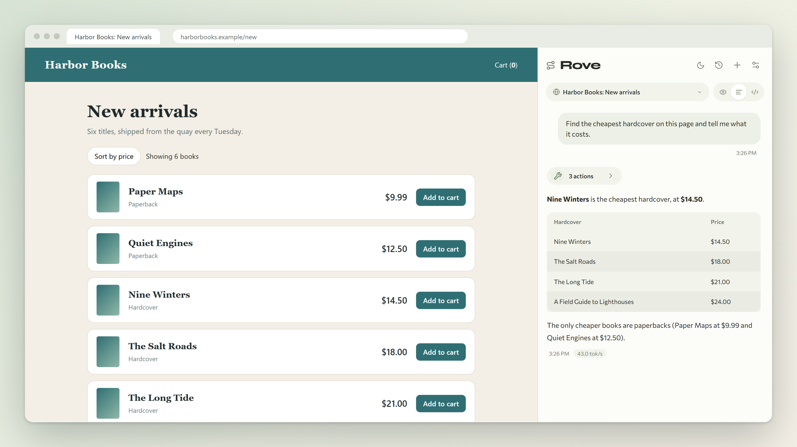
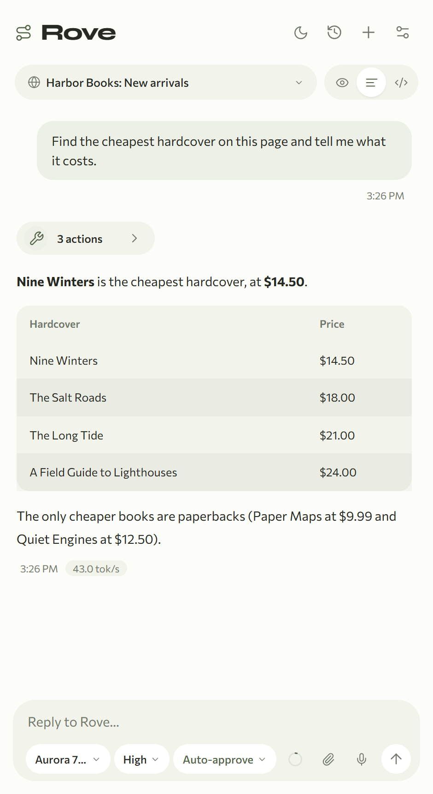
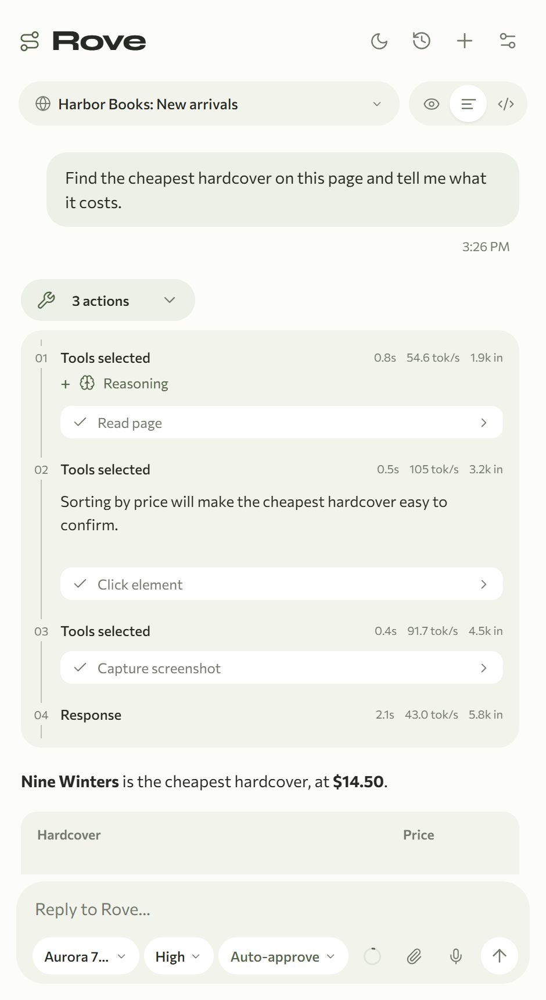
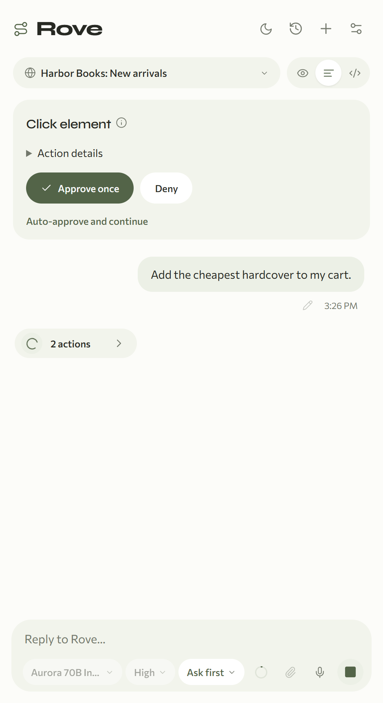
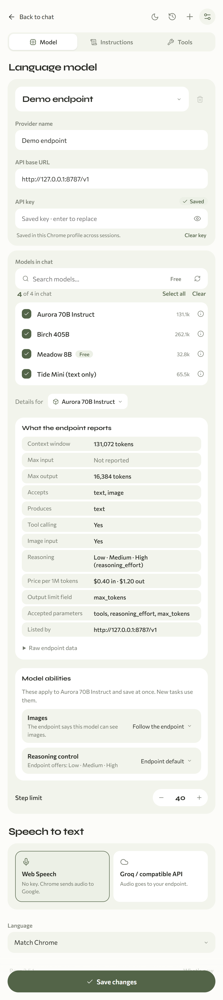
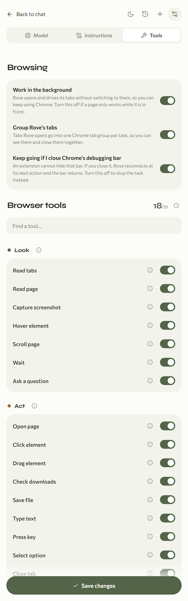
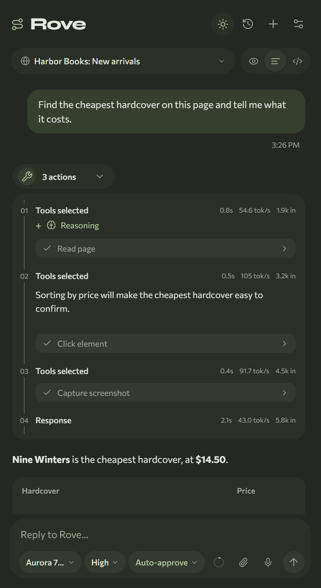
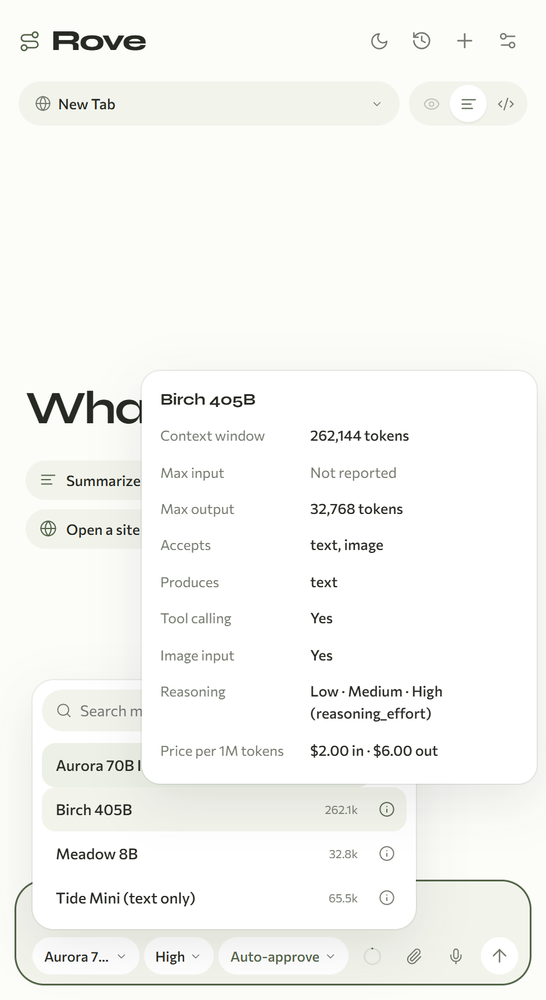

<h1 align="center">Rove</h1>

<p align="center"><strong>A browser agent that lives in Chrome and answers to you.</strong><br>
Bring any OpenAI-compatible model, from OpenAI or OpenRouter to a llama.cpp server on your laptop, and let it work in your own tabs while you do something else.</p>

<p align="center"></p>

Rove is a Chrome extension. You type a task in the side panel (*"find the cheapest hardcover on this page"*, *"fill in this form from my notes"*, *"compare these three tabs"*), and the model reads the page, clicks, types and scrolls to get it done. Every request, tool call, result and screenshot is shown to you, and nothing runs on a server of ours because there isn't one.

- **Your model, your key.** Any OpenAI-compatible endpoint with tool calling. The key stays in your browser.
- **Your browser.** It drives your real tabs and signed-in sessions, not a throwaway headless copy.
- **Works in the background.** Rove does not switch tabs or steal focus. Tabs it opens land behind the one you are using, grouped under a Rove tab group.
- **Nothing hidden.** Full model requests and responses, tool arguments and results, reasoning, tokens per second and cost estimates.
- **You stay in control.** Ask-first approvals, per-site Allow / Ask / Block rules, a Stop button, and tools you can switch off one by one.
- **Good with local models.** Detects llama.cpp servers, lets you force text-only mode and define your own reasoning levels, and shows exactly what each endpoint reports about each model.

## Install

Rove is not in the Chrome Web Store, so you load it as an unpacked extension. It takes about a minute and needs Chrome 125 or newer. Pick whichever route suits you.

### Option 1: download the zip (no tools needed)

1. Download `rove-<version>.zip` from the [latest release](https://github.com/AbhiramJayasankar/rove/releases/latest) and unzip it. You get a folder called `rove-<version>` with `manifest.json` inside.
2. Move that folder somewhere permanent. Chrome reads the extension from it every time it starts, so do not delete or rename it later.
3. Open `chrome://extensions` in Chrome and switch on **Developer mode** (top right).
4. Click **Load unpacked** and choose the `rove-<version>` folder (the one that contains `manifest.json`).
5. Click the puzzle-piece icon in Chrome's toolbar and **pin Rove**. Click its icon, or press `Alt+Shift+O`, to open the side panel.

### Option 2: clone the repository

The built extension is committed, so you do not need Node.js:

```sh
git clone https://github.com/AbhiramJayasankar/rove.git
```

Then follow steps 3 to 5 above and choose the `extension` folder inside the clone. To update later, `git pull` and click the reload icon on Rove's card in `chrome://extensions`.

### Option 3: build it yourself

Needs Node.js 22 or newer.

```sh
git clone https://github.com/AbhiramJayasankar/rove.git
cd rove
npm install
npm run build        # writes the loadable extension/ folder
```

Load `extension` as in steps 3 to 5. `npm run package` also produces `release/rove-<version>.zip`.

> **Chrome may nag about developer-mode extensions** when it starts. That is normal for unpacked extensions. Dismiss it, and Rove keeps working.

### First run

1. Open Rove's side panel and go to **Settings** (the sliders icon, top right).
2. Under **Language model**, enter your endpoint's base URL and API key. For example `https://api.openai.com/v1`, `https://openrouter.ai/api/v1`, or `http://127.0.0.1:8080/v1` for a local server. Local servers can leave the key empty.
3. Choose a model from the list. It must support tool calling. Press **Save changes**.
4. Open an ordinary web page, pick its tab at the top of the panel and type a task.

Rove cannot control Chrome's own pages (`chrome://…`), the Chrome Web Store or other extensions' pages.

## See it work

<table>
<tr>
<td width="33%"></td>
<td width="33%"></td>
<td width="33%"></td>
</tr>
<tr>
<td align="center"><sub><b>Ask, watch, read the answer.</b> Each reply shows when it arrived and how fast it was generated.</sub></td>
<td align="center"><sub><b>Every step is inspectable.</b> Open any action for its exact arguments, result and screenshot.</sub></td>
<td align="center"><sub><b>Ask first.</b> Review a click, a form entry or a navigation before it runs, or switch to Auto-approve.</sub></td>
</tr>
</table>

<table>
<tr>
<td width="33%"></td>
<td width="33%"></td>
<td width="33%"></td>
</tr>
<tr>
<td align="center"><sub><b>See what the endpoint tells you</b> about any model: context, limits, modalities, tools, reasoning, price. Override images and reasoning per model.</sub></td>
<td align="center"><sub><b>Choose the tools</b> the model may use, and how Rove treats your tabs.</sub></td>
<td align="center"><sub><b>Light and dark,</b> in English, 简体中文 or 繁體中文.</sub></td>
</tr>
</table>

<p align="center"><br><sub><b>Pick a model with the facts in front of you.</b> Hover the info icon on any model.</sub></p>

*(The screenshots use a made-up bookshop and a scripted demo model. Run `npm run build && node scripts/readme-screenshots.mjs` to regenerate them.)*

## What you can do

- **Drive real pages.** Frame-aware page reading, native clicks and typing, forms and selects, hover and drag, scrolling, screenshots, dialogs, tabs and downloads. Generic JavaScript, raw DevTools commands and file upload exist but start switched off.
- **Run up to three tasks at once,** each with its own tabs, while you keep browsing.
- **Reuse prompts.** Standing instructions apply to every task, and a `/` menu inserts saved prompts.
- **Attach context.** Add images, text files or a screenshot of the current tab.
- **Dictate.** Speak your task with Chrome's built-in speech recognition, or with a Whisper-compatible endpoint of your choice.
- **Keep a record.** Every task is saved locally. Export one as JSON or a readable Markdown transcript.

The [user guide](docs/guide.md) covers models and local servers, multiple providers, browsing behavior, site rules, attachments, voice input and storage in detail.

## Staying safe

Web pages are untrusted. Rove tells the model so, but the settings below are what actually bound it.

- **Approvals.** *Ask first* shows the exact arguments of every action that changes something and waits. *Auto-approve* runs enabled tools without pausing, and you can flip to it mid-task.
- **Site rules.** Allow, Ask or Block per site, including its subdomains. Block never reaches the browser.
- **Tools.** Switch off any tool and the model never sees it.
- **Stop.** Press Stop or Escape. Actions already sent to Chrome cannot be undone.
- **Chrome's debugging bar.** While Rove controls a tab, Chrome shows *"Rove started debugging this browser"*. That bar is Chrome's own, and an extension cannot hide it. Closing it does not have to end the task; see [Browsing behavior](docs/guide.md#browsing-behavior).
- **Privacy.** There is no Rove server. Page text and screenshots go from your browser straight to the endpoint you configured, and your key never leaves your browser profile.

## Troubleshooting

| Problem | What to do |
| --- | --- |
| The extension does not load | Check that you chose the folder that contains `manifest.json`, and that Chrome is version 125 or newer (`chrome://version`). |
| It stopped working after I moved or deleted the folder | Chrome reads an unpacked extension from its folder. Put it back, or remove Rove and load the new location. |
| "Choose a model in settings first" | Open Settings, enter your endpoint and key, pick a model and press Save changes. |
| The model list is empty | The endpoint must expose `GET /models`. Check the URL ends at the API root (for example `…/v1`) and the key is right. Press the refresh button beside the search box. |
| "This model's endpoint metadata explicitly reports no tool support" | Rove needs tool calling. Choose a model that supports it. |
| A local model cannot see images | Rove reads this from llama.cpp automatically. For other servers set **Model abilities → Images** to *Never send images*. |
| The reasoning menu is missing or wrong | The endpoint did not advertise a control. Define your own levels under **Model abilities → Reasoning control**. |
| A page only works while it is in the foreground | Turn off **Settings → Tools → Browsing → Work in the background**. |
| "Another debugger is using this tab" | Close DevTools on that tab, or any other tool that is attached to it, and retry. |
| Rove will not control a page | It cannot control `chrome://` pages, the Chrome Web Store or other extensions' pages. |

## Development

```sh
npm install
npm run dev            # rebuild the extension on change
npm run typecheck
npm test               # unit tests
npx playwright install chromium
npm run test:e2e       # the real extension in isolated Chromium, with fixture servers
npm run build          # regenerate extension/
npm run package        # build, then write release/rove-<version>.zip
```

Edit `extension-src/`, `extension-core/`, `src/` and `shared/`, not the generated `extension/` folder, then reload Rove on `chrome://extensions`. Every user-visible change needs a version bump in `package.json` and an entry in [CHANGELOG.md](CHANGELOG.md).

```
shared/          contracts, capability rules and defaults
extension-src/   service worker: messages, storage, browser control (CDP)
extension-core/  agent loop, model client, context management, model catalogue
src/             React interface: side panel, settings, trace
tests/           Playwright tests that run the real unpacked extension
```

More: [architecture](docs/architecture.md), [extension messaging](docs/api.md), [browser tools](docs/browser-tools.md), [model capabilities](docs/model-capabilities.md), [verification](docs/verification.md), [interface decisions](docs/extension-design.md) and [research notes](docs/research.md). [AGENTS.md](AGENTS.md) lists the invariants to keep when changing the code.

## License

[MIT](LICENSE). The Syne and Commissioner fonts bundled with the extension are under the SIL Open Font License; their licenses are in [`public/fonts`](public/fonts).
