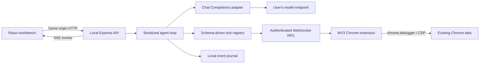

# Architecture

Relay is a local single-user application: one Node process, one React interface, and a small directly loadable Chrome extension. It has one active run because all actions affect a shared human browser session. Multiple simultaneous browser agents would compete for focus and page state; queueing is a deliberate future extension.

## Boundaries

`model.ts` knows the provider wire format, not Chrome. `tools.ts` knows tool schemas and handlers, not UI. `agent.ts` owns the conversation, budgets, approvals, and cancellation, using a `BrowserTransport` interface. `bridge.ts` correlates request IDs and owns connection failures/timeouts. `extension/background.js` owns privileged browser access. `store.ts` owns local persistence. `index.ts` composes them and exposes the HTTP/SSE surface.

The extension has no model credentials and no agent prompt. It executes one explicit command at a time and returns JSON. It has no page-message relay or external-message listeners: webpages cannot directly request privileged operations. Its popup is the only extension configuration surface.

## Run lifecycle

1. Validate task/configuration, capture a settings snapshot, create a run and record its status.
2. Construct the effective system message from the explicit base policy plus editable user instructions. Include the task and selected Chrome tab ID.
3. Send available tool schemas and current conversation to the configured Chat Completions endpoint. Trace the model request and response.
4. Validate each requested tool and its arguments. Ask for approval when required. Execute calls sequentially, returning success, denial, or actionable errors as tool results.
5. Capture passive screenshots after successful browser operations. Show observations in the UI; include images in model context only when vision is enabled. Image payloads are stored once as screenshot events rather than duplicated in request traces.
6. Continue until a final model answer, a step limit, an error, or a user stop. `ask_user` pauses the same run and resumes with the user's reply.

Context is bounded by a configurable token estimate, resolved from the selected model catalogue with an output reserve (or an explicit manual override). Base64 image bytes are never treated as text tokens. Up to four recent images are retained independently (configurable); complete tool-call groups and provider reasoning remain until the selected budget requires eviction. Each request logs its estimate, any removed messages/images, and subsequent provider-reported usage. The estimate is provider-neutral, not an exact tokenizer. HTTP/model requests and tool outputs have limits and timeouts. No automatic retries are applied to ambiguous browser mutations.

Streaming Chat Completions are assembled incrementally, including provider-returned reasoning and fragmented tool calls. Partial tool calls never execute. Stream deltas are journaled and shown live; completed reasoning is retained without display truncation. Reasoning and output-token parameter names are derived from advertised supported parameters; no model-name mapping is used. Unadvertised capabilities remain unknown, with explicit API-format overrides available.

Stop aborts pending model/HTTP requests, wakes approval waits, and prevents further browser dispatch. Chrome does not provide rollback for an action already sent. A disconnected extension rejects pending commands; reconnect never replays them. A process restart marks interrupted runs failed with an explicit event.

## Storage and events

`.relay/settings.json` stores non-key configuration; `.relay/pairing.json` stores the random pairing secret. Each run has small atomic metadata plus an append-only `*.events.jsonl` journal. Events are appended once rather than rewriting large screenshots and repeated request histories. The in-memory run index is rebuilt at startup. An incomplete final journal line is ignored during recovery.

SSE sends the initial state, new/terminal runs, incremental events, status changes, connection updates, and settings updates. The browser reconciles event IDs after reconnect. REST remains the source for full run retrieval and export. Runs remain inspectable after restart.

This avoids an external database and queue. A future database adapter can replace `Store`; transport and model adapters can evolve separately. For multi-user hosting, authentication, per-user browser ownership, isolated workers, encryption/key management, and an actual database become requirements; this loopback process should not simply be exposed on a public interface.

## Local access and secrets

- HTTP binds to `127.0.0.1`, checks Host and Origin, accepts JSON writes only, forbids framing, and sends no permissive CORS headers.
- The WebSocket requires a Chrome-extension Origin and a timing-safe comparison against a random 256-bit local pairing token. Rotating the token disconnects the existing bridge.
- Keys supplied through the UI live only in the backend process. `RELAY_API_KEY` is an optional environment source. Key values are redacted from text traces and errors; image pixels cannot be redacted reliably.
- Model and custom HTTP requests reject redirects so configured authorization headers are not silently sent to a different target.
- Raw JavaScript, CDP, and upload tools begin disabled. Custom scripts are explicit independent capabilities, with their own approval flag. They are powerful page code, not a sandbox.
- The backend checks every agent tool schema and excludes disabled tools. The manual observation API also validates built-in schemas. Explicit manual API commands are user operations, separate from the agent's enablement list.

Prompts are a behavioral defense, not a security boundary. Approvals are tool-level rather than a claim that an LLM can infallibly classify every button's effect. No telemetry or third-party analytics is installed.

## Model metadata and recovery

`catalogue.ts` normalizes endpoint labels, pricing, input/output/context limits, supported parameters, tools and modalities, while retaining raw model metadata. Cache entries are isolated by a hash of endpoint and credential; no key is persisted. The agent resolves metadata independently of the UI before each run. Unsupported tools fail early; explicitly unsupported vision is excluded from model input while screenshots remain available for the interface.

Context errors retain HTTP status, machine code, structured details and request IDs. Only explicit context rejections are retried, at most three times; authentication errors and arbitrary failures are not retried. Older images are removed before text history is compacted. Whole assistant/tool groups remain valid, prior progress receives a checkpoint, and original instructions/task remain. Provider-reported usage calibrates the prompt estimate. Successful conservative budgets are stored per endpoint/credential/model in `.relay/model-profiles.json`; the advertised model limit is never rewritten as a guess about the provider's actual internal limit. Profiles can be reset in Settings.
