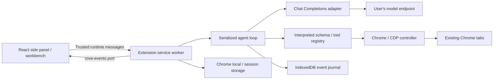

# Architecture

Rove v2 runs entirely inside Chrome. A Manifest V3 service worker composes the agent, model adapter, durable store and browser controller. The same React application serves the side panel and full options workbench. One run controls the shared browser session at a time.

## Boundaries

`extension-src/runtime.ts` owns trusted requests, event subscriptions, run admission, credentials and lifecycle. `store.ts` owns transactional settings/history persistence and interrupted-run recovery. `browser.js` owns Chrome permissions, debugger sessions, frame routing, transient refs and native input.

In `extension-core/`, `agent.ts` owns the conversation, approvals, cancellation and execution order. `conversation.ts` reconstructs a follow-up from the latest recorded request, completed response and tool outcomes. `model.ts` owns Chat Completions requests, streams and provider errors. `context.ts` manages token estimates and complete-group eviction. `tools.ts` defines the built-in browser tool schemas and dispatch through `BrowserTransport`. `catalogue.ts` normalizes endpoint metadata and persists credential-isolated learned limits. `provider-capabilities.ts` holds exact, sourced fallbacks for missing provider fields; endpoint metadata always wins. See [capability discovery](model-capabilities.md).

The worker uses browser APIs only. Tool schemas are interpreted by [@cfworker/json-schema](https://github.com/cfworker/cfworker/tree/master/packages/json-schema), avoiding runtime code generation under extension CSP. Advanced JavaScript executes explicitly in the selected page, rather than inside the worker. Removed custom-tool definitions are discarded from legacy settings; historical run events remain intact.

## Lifecycle and durability

1. Validate a task and reserve the single active run. Prepare the selected tab and attach a debugger before model work.
2. Record configuration and model metadata. Combine the base policy, editable instructions, task and selected-tab context.
3. Record the model request, flush the durable journal checkpoint, then request/stream the provider response. Partial tool calls never execute.
4. Validate tools and arguments; pause for required approval or a user answer. Record intent and commit a checkpoint before dispatch. Execute tools sequentially.
5. Capture passive screenshots after browser actions. Image events back the UI; supported model image inputs are selected automatically. Preserve valid structured snapshots, frame refs and pagination when bounding results.
6. Persist terminal state and learned limits, then release debugger sessions. Stop aborts requests/waits and prevents further dispatch; already-dispatched actions may finish.

Active debugger sessions keep extension workers alive in supported Chrome versions. Rove uses this during runs and releases the resource afterward, following Chrome's [worker lifecycle guidance](https://developer.chrome.com/docs/extensions/develop/concepts/service-workers/lifecycle). This does not replace crash recovery: on worker initialization, a previously active run becomes failed with an interruption event. Startup also releases debugger sessions left attached by the previous worker; Chrome scopes detach to the calling extension. Actions are never replayed automatically.

Debugger preflight uses `Target.getTargetInfo`, which does not wait for a renderer blocked by a JavaScript dialog. A new task can reset a stale owned attachment before dispatch. Orphaned clients are verified using an extension-scoped command and reset to rebuild frame subscriptions; clients belonging to DevTools or other extensions are not detached. Closing a tab intentionally first releases its session. Session cancellation clears outstanding command deadlines so old work cannot later detach a new session. Lost iframe sessions invalidate that frame's references, without detaching the root tab. Unexpected root loss during a task still stops the task without replaying the command.

Chrome's root `onDetach` notification has no session generation. Rove confirms ownership with a bounded, read-only probe before clearing the tracked client; dispatch waits for that check. A delayed notification from an old client cannot delete a healthy replacement during initialization. A genuinely disconnected client still stops the active task, without reattaching or replaying the in-flight action.

Explicit task admission activates the selected tab before enabling renderer domains. Background/discarded renderers can accept a debugger client while failing to answer `Page.enable` until awakened. Initialization preserves that command's original error and stops immediately; it must not swallow the timeout and issue `Runtime.enable` against the disposed client. The command timeout settles before session cancellation so its precise cause is retained.

Task admission rechecks idle cleanup after releasing its startup guard. A fast terminal response may have completed before the admission RPC returns; its earlier terminal cleanup intentionally skips while startup owns the client. The final recheck flushes the journal/catalogue and releases idle clients so that skipped cleanup cannot leak an attachment.

Context admission reserves output capacity, accounts for images independently of base64 transport size, and retains complete assistant/tool groups. Advertised limits, estimates and provider usage stay distinct. Structured context failures permit bounded recovery of the model request; successful reduced input/image budgets are learned without replaying browser mutations.

## Chat continuation

A chat retains one run ID across user turns. POST messages appends a user_message event and re-enters the serialized agent loop. Steps and event IDs remain monotonic. Reconstruction uses the latest context-admitted request and subsequent confirmed results; it never re-dispatches historical tools. Missing results in an interrupted batch become explicit unknown-outcome tool responses. Image observations reference screenshot event IDs, so reused provider call IDs cannot substitute the wrong image. Legacy ambiguous image references are omitted with a fresh-observation instruction. Current system instructions replace the historical system message. Worker restart still marks an in-flight response failed; the user can explicitly send a follow-up afterward.

Editing a message explicitly replaces history from that turn onward. The retained prefix commits atomically in IndexedDB, and the chat revision increases so UI caches cannot merge removed events back into the edited chat. Event IDs remain monotonic within each revision. Existing browser effects are not undone. Questions and replies render together inside the tool step that requested input, including when viewing saved history; returned `user_question.callId` and `user_reply.questionId` also link the raw events.

The UI renders turns chronologically and keeps the chat mounted while settings is open. Per-chat drafts and scroll state remain available on return. History orders chats by their latest activity. Model search, effort and approval controls share anchored popover behavior. shared/usage.ts totals response usage across model changes and keeps current context, reservations, cumulative input/output, cached/reasoning tokens and cost separate. Unreported/interrupted usage is never represented as complete zero-cost usage.

## Storage

| Data                                 | Location                         | Lifetime                                                                              |
| ------------------------------------ | -------------------------------- | ------------------------------------------------------------------------------------- |
| Normalized settings | `chrome.storage.local` | Persistent extension data; automatic context/reasoning format, streaming and vision |
| Learned model limits                 | `chrome.storage.local`           | Persistent, indexed by endpoint/credential SHA-256 and model                          |
| Model API key | Dedicated trusted `chrome.storage.local.modelApiKey` | Persists across worker/browser/extension restarts until explicitly cleared or the extension is uninstalled |
| Run metadata and events              | IndexedDB                        | Persistent history; event records append by run/event ID                              |

Run metadata and new events commit in one IndexedDB transaction. `save` queues writes; `checkpoint`/`flush` awaits completion before requests or actions. Storage failures stop dispatch. The UI loads run summaries first and retrieves complete history when needed. Chunked `rove-rpc` transfers avoid Chrome's per-message size limit for large histories. Event IDs reconcile live updates; a reconnected `rove-events` port receives fresh state.

Credentials never enter settings, history, run exports or API responses. Startup restricts local/session storage to trusted extension contexts, migrates a retained legacy session credential only if no persistent credential exists, then removes the old session entry. Saving an empty key clears the persistent credential; omitting it retains the existing one. Individual runs remain exportable; whole-history backup/import is removed.

## Trust and permissions

Only pages with this extension's identity and URL may call the privileged runtime or open event ports. There are no external-message listeners, page-content relays, HTTP listeners or pairing tokens. The manifest grants debugger, tabs, storage, downloads and side-panel capabilities plus HTTP(S) host access for browser tasks and chosen endpoints.

Model requests reject redirects. Text traces redact the configured model key; screenshot pixels cannot be reliably redacted. Web observations sent to the model go to the selected provider. Generic evaluation, raw CDP and file uploads begin disabled. Prompts guide behavior, while permissions, validation, scoped routing and approval decisions provide enforceable boundaries. Candidate model catalogue lookups validate unsaved endpoint/key inputs without saving or broadcasting them as the active configuration.

## Keeping the panel in sync

The worker pushes events over a long-lived port, but a port can drop or stall and nothing replays what it missed. The panel therefore reconciles against stored state: on every (re)connect, when it regains focus, and every 4 s while a task is active it compares `/api/state` summaries (status, revision, `lastEventId`) with its own copy and re-fetches any run that differs. `tests/extension/resync.spec.ts` covers a port that never delivers.

Other behavior worth knowing: a model request times out on silence rather than total duration; an empty final reply is retried twice before the task fails; only Cancel on Chrome's debugging banner or losing the tab in use stops a task on a debugger detach; model and reasoning cannot change mid-task.
